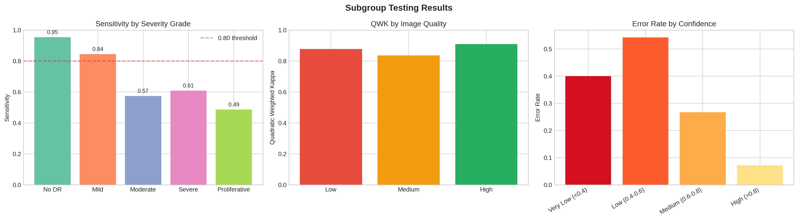
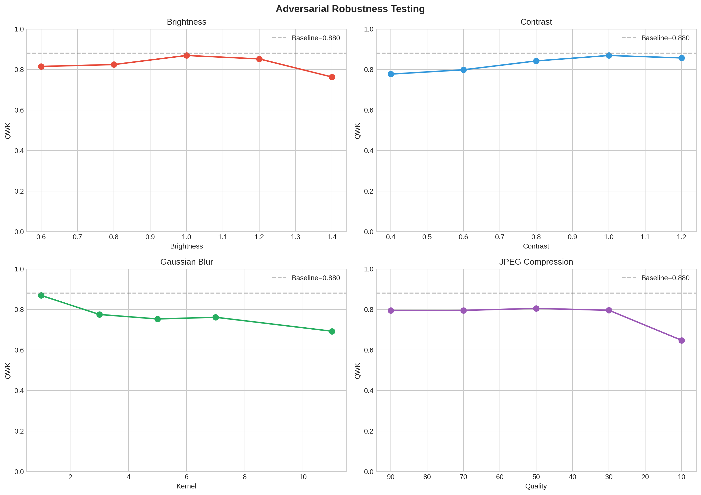

# Algorithmic Audit of a Diabetic Retinopathy Classifier

**A 0.88 headline score hid 48.6% sensitivity on the most urgent grade.**

[](https://www.python.org/)
[](https://pytorch.org/)
[](LICENSE)

Built by [Riya Shet](https://www.linkedin.com/in/riyashet/) | MSc Health Data Science, University of Birmingham

---

## The Problem

A model can report 88% agreement with expert graders and still miss over half of the most dangerous cases. Aggregate metrics like accuracy and kappa hide failures that only show up when you break the results down by severity grade, image quality, and model confidence. In a clinical setting, those hidden failures translate directly into delayed treatment and preventable vision loss.

This project is a structured audit of a diabetic retinopathy (DR) classifier -- not just asking "how accurate is it?" but asking "where does it fail, how badly, and what would happen to a patient if it did?"

## What This Project Does

This repo takes a trained ResNet-50 DR classifier from my [retinal-fundus-classification](https://github.com/riyashet-hds/retinal-fundus-classification) project and puts it through a systematic safety evaluation using the Medical Algorithmic Audit framework (Liu et al., *Lancet Digital Health*, 2022). The audit covers:

- **Error analysis** -- categorising every misclassification by direction (undergrading vs overgrading) and severity distance
- **Subgroup testing** -- checking if the model performs equally across DR severity grades, image quality levels, and confidence bands
- **Adversarial robustness** -- simulating real-world image degradation (blur, brightness, contrast, JPEG compression) and measuring how much performance drops
- **Risk scoring** -- mapping each failure mode to its clinical consequence using Failure Modes and Effects Analysis (FMEA)
- **Dataset documentation** -- auditing the training data itself using the STANDING Together recommendations (Alderman et al., *Lancet Digital Health*, 2025)

## Key Findings

| Finding | Detail |
|---------|--------|
| **Aggregate metrics mask critical failures** | QWK = 0.88 looks strong, but Proliferative DR sensitivity is just 48.6% -- worse than a coin flip for the most dangerous grade |
| **The model undergradesmore than it overgrades** | 56% of errors (54/96) are undergrading, meaning the model is more likely to say a case is less severe than it actually is |
| **Rare severe classes fail the most** | Sensitivity: No DR 95.3%, Mild 84.4%, Moderate 57.4%, Severe 60.9%, Proliferative 48.6% |
| **Confidence scores are well-calibrated** | Error rate at high confidence (>0.8): 7.2%. At low confidence (0.4-0.6): 54.3%. The model knows when it's unsure. |
| **Blur is the most damaging perturbation** | Gaussian blur (kernel=11) drops QWK from 0.87 to 0.69. JPEG compression at quality=10 drops it to 0.65. |
| **The dataset has no demographic data** | Age, sex, and ethnicity are not recorded in APTOS, so fairness across population groups cannot be assessed at all |

### Sensitivity by Severity Grade



The model performs well on healthy retinas (No DR) and mild cases, but sensitivity drops sharply for the clinically urgent grades. Proliferative DR -- the grade that requires emergency referral -- is correctly identified less than half the time.

## Audit Framework

The audit follows the SMACTR methodology (Raji et al., 2020), adapted for medical AI. In simple terms: scope the task, map the risks, gather evidence, test for failures, and reflect on what to do about them.

| Phase | What it does | Where in the notebook |
|-------|-------------|----------------------|
| **Scoping** | Defines what the model is supposed to do and what happens when it's wrong | Section 2 |
| **Mapping** | Lists everything that could go wrong -- bad data, architecture limits, deployment risks | Section 3 |
| **Artifact Collection** | Documents the dataset's composition, gaps, and biases | Section 4 |
| **Testing** | Runs three types of tests: error analysis, subgroup testing, adversarial robustness | Sections 5-8 |
| **Reflection** | Scores each failure mode by severity and frequency, recommends mitigations | Sections 9-10 |

## Model Under Audit

The audited model is a **ResNet-50** fine-tuned on the APTOS 2019 dataset. Full training pipeline and comparison with a ViT-B/16 are in the [parent repository](https://github.com/riyashet-hds/retinal-fundus-classification).

| Property | Value |
|----------|-------|
| Architecture | ResNet-50 (timm) |
| Pre-training | ImageNet-1K |
| Fine-tuned layers | layer3, layer4, classifier head |
| Input resolution | 224 x 224 |
| Preprocessing | Ben Graham's method (crop, resize, Gaussian contrast normalisation) |
| Loss function | Cross-entropy with inverse-frequency class weights |
| Optimiser | AdamW (lr=1e-4, weight_decay=1e-4) |
| Primary metric | Quadratic Weighted Kappa (QWK) -- penalises large grading errors more than small ones |

## Dataset

The [APTOS 2019 Blindness Detection](https://www.kaggle.com/c/aptos2019-blindness-detection) dataset contains 3,662 retinal fundus photographs graded on a 5-level scale. It was documented following the STANDING Together consensus recommendations for health dataset transparency:

| Attribute | Detail | Status |
|-----------|--------|--------|
| Source | APTOS 2019 Kaggle competition; Aravind Eye Hospital, India | Documented |
| Sample size | 3,662 images (2,930 used after filtering) | Documented |
| Severity split | No DR 49%, Mild 10%, Moderate 28%, Severe 5%, Proliferative 8% | Documented |
| Labelling | Clinician-graded, International Clinical DR Scale (0-4) | Documented |
| Age, sex, ethnicity | **Not provided** | Not available |
| Camera/device | **Not specified** | Unknown |
| Geographic origin | Single centre, southern India | Documented |

The complete absence of demographic metadata means we cannot test whether the model performs differently across age groups, sexes, or ethnicities. Among 36 approved ophthalmic AI devices reviewed in a recent scoping study, only 52% of validation datasets reported age and 21% reported ethnicity -- so this gap is common, but it remains a fundamental limitation.

## Subgroup and Robustness Testing

### Per-class performance

| Class | N (test) | Sensitivity | Specificity | F1 | Avg Confidence |
|-------|:--------:|:-----------:|:-----------:|:--:|:--------------:|
| No DR | 215 | 0.953 | 0.964 | 0.958 | 0.952 |
| Mild | 45 | 0.844 | 0.916 | 0.655 | 0.708 |
| Moderate | 122 | 0.574 | 0.956 | 0.680 | 0.621 |
| Severe | 23 | 0.609 | 0.940 | 0.452 | 0.657 |
| Proliferative | 35 | 0.486 | 0.960 | 0.500 | 0.652 |

### Adversarial robustness

Four perturbation types were tested, each simulating a real-world image quality issue:



Gaussian blur and extreme JPEG compression cause the largest drops. Blur (kernel=11) reduces QWK from 0.87 to 0.69, simulating camera defocus or patient movement. JPEG at quality=10 drops QWK to 0.65, relevant for telemedicine where images are compressed for transmission. Moderate compression (quality >= 30) is well-tolerated.

## Risk Priority (FMEA)

Each failure mode is scored using Failure Modes and Effects Analysis -- a structured way to rank risks by how severe the consequence is and how often the failure occurs. RPN = Severity x Occurrence.

| Failure Mode | Clinical Consequence | Severity | Occurrence | RPN |
|-------------|---------------------|:--------:|:----------:|:---:|
| Proliferative DR undergraded (51.4%) | Delayed emergency referral; risk of vitreous haemorrhage | 4 | 4 | **16** |
| Moderate DR undergraded (42.6% error) | Extended screening interval; disease progression | 3 | 4 | **12** |
| Severe DR undergraded (21.7%) | Delayed urgent referral; macular oedema progression | 4 | 3 | **12** |
| Adjacent undergrading | Slightly extended follow-up | 2 | 4 | **8** |
| Image quality degradation | Unpredictable errors | 3 | 2 | **6** |
| Adjacent overgrading | Unnecessary early referral | 1 | 3 | **3** |

Severity scale: 4 = Catastrophic, 3 = Major, 2 = Moderate, 1 = Minor. Occurrence scale: 4 = >30% of relevant cases, 3 = 10-30%, 2 = 3-10%, 1 = <3%.

## Recommendations

| Recommendation | Type | Rationale |
|---------------|------|----------|
| Human review for all Severe/Proliferative predictions | Clinical workflow | Sensitivity below 50% for Proliferative, 61% for Severe |
| Route predictions with confidence < 0.6 to human review | Confidence triage | 54.3% error rate in the low-confidence band |
| Image quality gate before model inference | Pre-processing | Blur and compression degrade QWK by up to 0.22 |
| External validation with demographic metadata | Evaluation | Cannot assess fairness on APTOS |
| Report per-class sensitivity, not just aggregate QWK | Reporting standard | Aggregate QWK of 0.88 masks 48.6% Proliferative sensitivity |

## What I Learned

When I finished the [parent project](https://github.com/riyashet-hds/retinal-fundus-classification), I felt like the work was done. I had trained three models, compared their QWK and accuracy, concluded that ResNet-50 had the best kappa (0.89) while ViT had the best accuracy (81.4%), and written it up. That felt like a complete evaluation.

This audit changed that. The structured framework forced me to ask questions I hadn't thought to ask during training. What happens when the model is wrong on the cases that matter most? The answer -- 48.6% sensitivity on Proliferative DR, the grade that requires emergency referral -- was not visible from the aggregate QWK of 0.88. It only appeared when I broke the results down by severity grade. That single finding reframed what I thought "good performance" meant.

The audit also changed how I think about datasets. During training, I treated APTOS as a straightforward image classification dataset. Documenting it against the STANDING Together framework made the limitations concrete: no age, no sex, no ethnicity, no camera metadata, single-centre, single-geography. These aren't just bullet points in a limitations section -- they're specific, measurable gaps that mean this model cannot be deployed in a real screening programme, regardless of its QWK. A scoping review of 36 approved ophthalmic AI devices found that 19% had no published evidence and most validation datasets lacked demographic reporting. The standards for deployment are far higher than what a training-focused project typically produces.

Going from model training to model auditing felt like the difference between building something and stress-testing it. Both are necessary, but the second one is what determines whether the thing is actually safe to use.

## Repository Structure

```
dr-algorithmic-audit/
├── algorithmic-audit.ipynb   # Full audit notebook (Kaggle run with outputs)
├── README.md                 # This file
├── requirements.txt          # Python dependencies
├── LICENSE                   # MIT License
├── figures/                  # Generated visualisations
│   ├── adversarial_robustness.png
│   ├── confusion_matrix_baseline.png
│   ├── error_analysis.png
│   ├── gradcam_error_comparison.png
│   └── subgroup_testing.png
└── models/                   # Place pre-trained weights here
    └── .gitkeep              # (best_ResNet50.pt from parent repo)
```

## Quick Start

### Option 1: Run on Kaggle (recommended -- no local GPU needed)

1. Open the notebook on [Kaggle](https://www.kaggle.com/) and attach the [APTOS 2019](https://www.kaggle.com/c/aptos2019-blindness-detection) dataset and your model weights as inputs
2. Click **Run All**

### Option 2: Run locally

```bash
git clone https://github.com/riyashet-hds/dr-algorithmic-audit.git
cd dr-algorithmic-audit
pip install -r requirements.txt
```

You'll need:
- The [APTOS 2019 dataset](https://www.kaggle.com/c/aptos2019-blindness-detection) (requires Kaggle account)
- Pre-trained ResNet-50 weights (`best_ResNet50.pt`) from the [parent repo](https://github.com/riyashet-hds/retinal-fundus-classification)
- Place weights in `models/` and update dataset paths in the notebook

## References

1. Liu X, Glocker B, McCradden MM, Ghassemi M, Denniston AK, Oakden-Rayner L. "The Medical Algorithmic Audit." *Lancet Digital Health* 2022; 4(5): e384-e397. DOI: [10.1016/S2589-7500(22)00003-6](https://doi.org/10.1016/S2589-7500(22)00003-6)

2. Alderman JE, Palmer J, Laws E, et al. "STANDING Together consensus recommendations." *Lancet Digital Health* 2025; 7(1): e64-e88. DOI: [10.1016/S2589-7500(24)00224-3](https://doi.org/10.1016/S2589-7500(24)00224-3)

3. Ong AY, Hogg HDJ, Kale AU, et al. "Scoping review of AIaMD for ophthalmic image analysis." PMC 2024. PMC: [PMC12122805](https://pmc.ncbi.nlm.nih.gov/articles/PMC12122805/)

4. Liu X, Faes L, Kale AU, et al. "DL performance vs health-care professionals: systematic review." *Lancet Digital Health* 2019; 1(6): e271-e297. DOI: [10.1016/S2589-7500(19)30123-2](https://doi.org/10.1016/S2589-7500(19)30123-2)

5. Raji ID, Smart A, White RN, et al. "Closing the AI accountability gap." *ACM FAccT* 2020.

6. Selvaraju RR, et al. "Grad-CAM: Visual Explanations from Deep Networks." *ICCV* 2017.

7. Graham B. Kaggle Diabetic Retinopathy Detection, 1st Place Solution. 2015.

## License

This project is licensed under the [MIT License](LICENSE).
